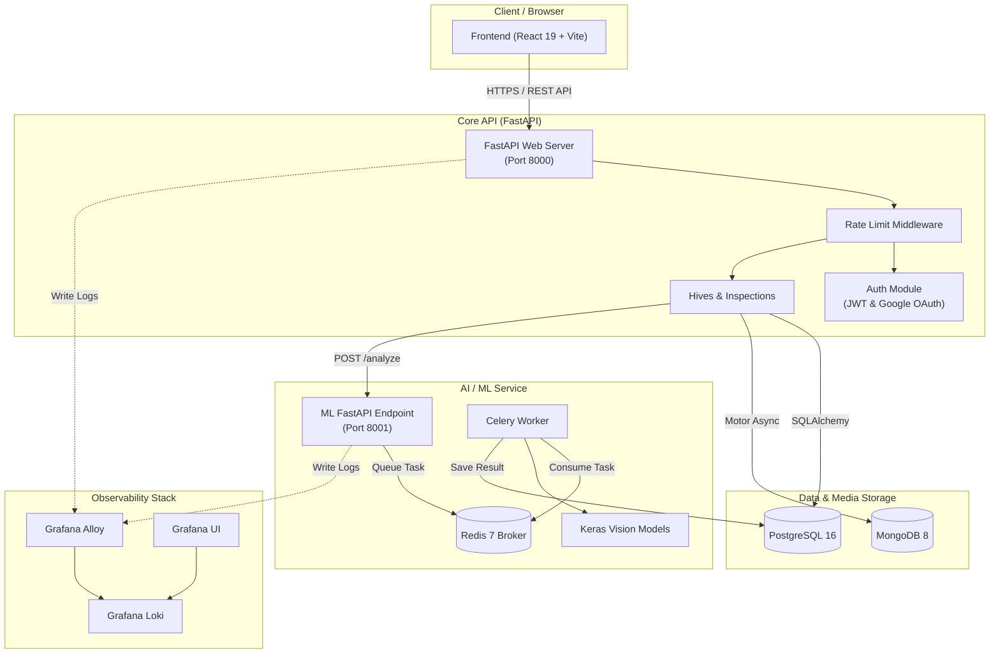

# Melitrack

> Intelligent and integrated platform for stingless hive management, computer vision AI analysis, product harvest tracking, and real-time observability.

[](https://www.python.org/)
[](https://fastapi.tiangolo.com/)
[](https://react.dev/)
[](https://www.typescriptlang.org/)
[](https://www.postgresql.org/)
[](https://www.mongodb.com/)
[](https://redis.io/)
[](https://www.docker.com/)
[](LICENSE)

[🇧🇷 Versão em Português](README.pt-BR.md)

🌐 **Access the system:** [melitrack.vercel.app](https://melitrack.vercel.app/)

## About

Melitrack is a modern platform designed specifically for stingless beekeepers (_Meliponini_). It combines hive geolocations, periodic inspection logging, AI-driven image analysis for species identification and colony health evaluation, harvest tracking, and real-time ecosystem observability in a single integrated solution.

Built with a resilient microservices architecture, Melitrack offers a decoupled system separating core web business logic, asynchronous machine learning task queues, polyglot storage, and an observability pipeline.

### Key Differentiators

- 🐝 **Stingless Hive Management** with geolocated coordinates, species catalog, box models, and photo histories.
- 🔍 **AI Photo Analysis** powered by computer vision models (TensorFlow/Keras + Celery + Redis) for species & health verification.
- 🍯 **Harvest & Yield Tracking** for honey, propolis, pollen, geopropolis, and wax with quantitative metrics.
- 📊 **Real-Time Observability** with central log aggregation and visualization using Grafana, Loki, and Grafana Alloy.
- 🔒 **Hybrid Security & Rate Limiting** with HttpOnly cookies, JWT fallback, Google OAuth2, and IP-based rate limiting.
- 🗄️ **Polyglot Data Storage** pairing PostgreSQL 16 (relational integrity) with MongoDB 8 (high-volume photo storage).
- 🌐 **Interactive OpenAPI Documentation** available out-of-the-box via Swagger UI and ReDoc.

---

## Features

### Hive Management Module

- ✅ Geolocated hive registration (latitude/longitude, species like _Jataí_, _Mandaçaia_, _Uruçu_, _Bugia_, box types like INPA, AF)
- ✅ Comprehensive history of photos stored in MongoDB GridFS/documents
- ✅ Individual hive details, edit operations, and cascading deletes

### Inspections & AI Analysis

- ✅ Field inspection logs (colony health, queen presence, population estimates, honey reserves, notes)
- ✅ Inspection photo uploads with automated asynchronous ML task queue triggering
- ✅ Computer vision predictions for species identification and health evaluation (TensorFlow/Keras)
- ✅ User manual override and correction of AI prediction results

### Harvest & Products Module

- ✅ Product catalog management (Honey, Propolis, Pollen, Geopropolis, Wax)
- ✅ Quantitative harvest recording tied to specific hives and dates
- ✅ Historical extraction logs and yield analytics

### Authentication & Security

- ✅ Secure HttpOnly cookie session management (`melitrack_session`) with Bearer token fallback
- ✅ Native Google OAuth2 integration for social login
- ✅ Granular rate limiting (5 req/min on login, 300 req/min general, custom limits for password resets)
- ✅ Password hashing with Bcrypt and JWT token lifecycle management

### Observability & Infrastructure

- ✅ Automated log tailing across services (`api.log`, `ml.log`, `ml-worker.log`) via Grafana Alloy
- ✅ Centralized log indexing with Grafana Loki and visual dashboard monitoring in Grafana
- ✅ Fully dockerized deployment with containerized services on a dedicated bridge network (`melitrack-network`)

---

## Tech Stack

### Backend

- **Language:** Python 3.12
- **Framework:** FastAPI 0.110+
- **ORM & Migrations:** SQLAlchemy 2.0 & Alembic
- **Authentication:** PyJWT, Passlib (Bcrypt), Authlib (Google OAuth2)
- **Async DB Drivers:** asyncpg, Motor (MongoDB Async)

### Machine Learning Engine

- **Framework:** FastAPI (ML Gateway) & Celery 5 (Worker Pool)
- **Broker & Cache:** Redis 7
- **Models:** TensorFlow / Keras (Computer Vision) & iNaturalist API Integration
- **Async Execution:** Task queue with `202 Accepted` response pattern

### Database & Storage

- **Relational DB:** PostgreSQL 16 (Users, Hives, Inspections, ML Predictions, Harvests)
- **NoSQL DB:** MongoDB 8 (Binary photo storage & media metadata)

### Frontend

- **Framework:** React 19.2.7 with TypeScript 6.0.2
- **Build Tool:** Vite 8.1.1
- **Styling:** Tailwind CSS 3.4.19 & PostCSS
- **Icons:** Lucide React
- **Routing:** React Router DOM v7

### Observability & Infrastructure

- **Log Collection:** Grafana Alloy Agent
- **Log Storage:** Grafana Loki (Port 3100)
- **Visualization:** Grafana Dashboards (Port 3000)
- **Containers:** Docker & Docker Compose

---

## Architecture Overview



---

## API Documentation

### Interactive Documentation

Once the server is running, access:

- **Swagger UI:** http://localhost:8000/docs
- **ReDoc:** http://localhost:8000/redoc
- **OpenAPI Schema:** http://localhost:8000/openapi.json

### Main Endpoints

#### Authentication (`/auth`)

```http
POST /auth/register           # Register a new stingless beekeeper account
POST /auth/login              # Local authentication and HttpOnly cookie issuance
GET  /auth/me                 # Get current authenticated user profile
PUT  /auth/me                 # Update profile data and meliponary preferences
POST /auth/forgot-password    # Request password reset code
POST /auth/reset-password     # Reset password using confirmation code
GET  /auth/google             # Initiate Google OAuth2 login flow
GET  /auth/google/callback    # Google OAuth2 callback endpoint
POST /auth/logout             # Revoke session cookie
```

#### Hives (`/hives`)

```http
GET    /hives                             # List all hives owned by user
POST   /hives                             # Register a new hive (species, model, location)
GET    /hives/{hive_id}                   # Get details for a specific hive
PUT    /hives/{hive_id}                   # Update hive details
DELETE /hives/{hive_id}                   # Delete hive and associated inspections/photos
GET    /hives/{hive_id}/photos            # List hive photos in MongoDB
POST   /hives/{hive_id}/photos            # Upload a hive photo (max 10MB)
DELETE /hives/{hive_id}/photos/{photo_id} # Delete a photo from MongoDB
```

#### Inspections & AI Analysis (`/hives/{hive_id}/inspections`)

```http
GET   /hives/{hive_id}/inspections                    # List all hive inspections
POST  /hives/{hive_id}/inspections                    # Register a new field inspection
GET   /hives/{hive_id}/inspections/{id}               # Inspection details and ML prediction
POST  /hives/{hive_id}/inspections/{id}/photos        # Upload photo & trigger AI processing
PATCH /hives/{hive_id}/inspections/{id}/ml-correction # Correct AI prediction manually
```

#### Harvests & Products (`/harvests` & `/products`)

```http
GET  /products        # List product catalog (Honey, Propolis, Pollen, etc.)
POST /products        # Add new product category to catalog
GET  /harvests        # List user harvest history
POST /harvests        # Record a new harvest from a specific hive
```

#### Health Check (`/health`)

```http
GET /health           # System health check (PostgreSQL and MongoDB status)
```

#### ML Internal API (Port 8001)

```http
POST /analyze         # Accept image payload and trigger Celery pipeline
GET  /species         # List supported stingless bee species
GET  /health          # Check ML service and Redis connectivity
```

### Example Usage

#### 1. Authenticate Beekeeper

```bash
curl -X POST http://localhost:8000/auth/login \
  -H "Content-Type: application/json" \
  -d '{"email": "beekeeper@melitrack.io", "password": "SecurePassword123"}' \
  -c cookies.txt
```

#### 2. Create Hive

```bash
curl -X POST http://localhost:8000/hives \
  -H "Content-Type: application/json" \
  -b cookies.txt \
  -d '{
    "name": "Colméia Jataí 01",
    "species": "Melipona subnitida",
    "box_type": "INPA",
    "latitude": -23.55052,
    "longitude": -46.633308
  }'
```

#### 3. Upload Inspection Photo & Trigger AI Analysis

```bash
curl -X POST http://localhost:8000/hives/1/inspections/5/photos \
  -b cookies.txt \
  -F "file=@/path/to/inspection_photo.jpg"
```

---

## Documentation Index

Detailed topic guides are available in the [`docs/en/`](docs/en/) directory:

| Document                                                   | Description                                                                                       |
| :--------------------------------------------------------- | :------------------------------------------------------------------------------------------------ |
| 🏗️ [**System Architecture**](docs/en/ARCHITECTURE.md)      | In-depth microservices breakdown, Docker network, task queues, and logging flow.                  |
| 🗄️ [**Database Model**](docs/en/DATABASE.md)               | Hybrid database schema (PostgreSQL + MongoDB), collections, and ER diagram.                       |
| 🔌 [**Services & APIs**](docs/en/SERVICES_AND_API.md)      | Complete REST API specification, authentication rules, rate limits, and error handling.           |
| 🚀 [**Setup & Execution Guide**](docs/en/SETUP_AND_RUN.md) | Step-by-step instructions to launch the stack via Docker Compose and configure environment files. |

---

## License

This project is licensed under the MIT License - see the [LICENSE](LICENSE) file for details.

## 👥 Authors

- **Lucas Blanger** - [](https://www.linkedin.com/in/lucas-blanger-4668a2210/)

---

**Made with ❤️ for stingless beekeeping**
