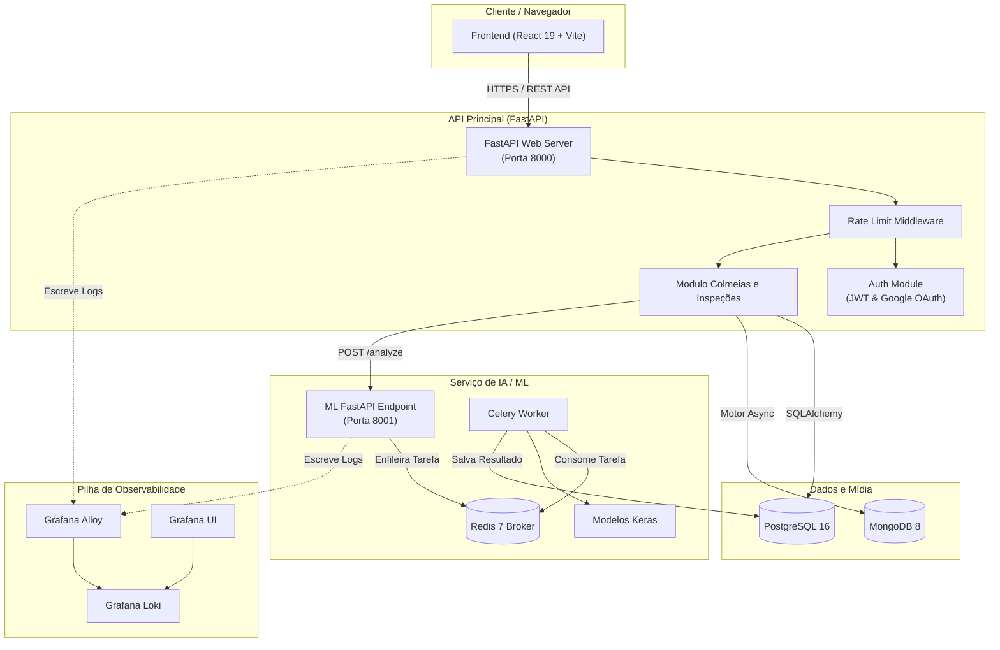

# Melitrack

> Plataforma inteligente e integrada para gestão de meliponários, visão computacional para análise de colmeias, controle de colheitas e observabilidade em tempo real.

[](https://www.python.org/)
[](https://fastapi.tiangolo.com/)
[](https://react.dev/)
[](https://www.typescriptlang.org/)
[](https://www.postgresql.org/)
[](https://www.mongodb.com/)
[](https://www.docker.com/)
[](LICENSE)

[🇺🇸 English Version](README.md)

## Sobre

O **Melitrack** é uma plataforma moderna desenvolvida para auxiliar meliponicultores no manejo eficiente de colmeias de abelhas sem ferrão (_Meliponini_). O sistema combina cadastro geolocalizado, registro de inspeções periódicas, análise inteligente de imagens por visão computacional (identificação de espécies e avaliação de saúde), controle quantitativo de colheitas e observabilidade completa do ecossistema.

Construído sob uma arquitetura resiliente de microserviços, o Melitrack desacopla as regras de negócio da API principal, o processamento assíncrono de machine learning, o armazenamento poliglota de dados e o pipeline de logs em tempo real.

### Diferenciais

- 🐝 **Gestão de Colmeias Meliponíneas** com coordenadas geográficas, catálogo de espécies, modelos de caixas e histórico de fotos.
- 🔍 **Análise Fotográfica por IA** alimentada por modelos de visão computacional (TensorFlow/Keras + Celery + Redis) para validação de espécie e saúde.
- 🍯 **Controle de Colheitas e Produção** de Mel, Própolis, Pólen, Geopropólis e Cera com métricas quantitativas.
- 📊 **Observabilidade em Tempo Real** com centralização, agregação e visualização de logs utilizando Grafana, Loki e Grafana Alloy.
- 🔒 **Segurança Híbrida e Rate Limit** com Cookies HttpOnly, suporte a header Bearer JWT, Google OAuth2 e limitação de requisições por IP.
- 🗄️ **Armazenamento Poliglota** unindo PostgreSQL 16 (integridade relacional) com MongoDB 8 (armazenamento de alto volume de imagens).
- 🌐 **Documentação Interativa OpenAPI** disponível diretamente via Swagger UI e ReDoc.

---

## Funcionalidades

### Módulo de Gestão de Colmeias

- ✅ Cadastro geolocalizado de caixas (latitude/longitude, espécies como _Jataí_, _Mandaçaia_, _Uruçu_, _Bugia_, tipos de caixa como INPA, AF)
- ✅ Histórico completo de fotos armazenadas no MongoDB
- ✅ Detalhamento individual de colmeias, edição e remoção em cascata

### Inspeções & Análise por IA

- ✅ Lançamento de inspeções de campo (saúde da colônia, presença da rainha, estimativa de população, nível de mel e observações)
- ✅ Upload de foto na inspeção com disparo automático da fila de análise assíncrona de ML
- ✅ Predições de visão computacional para identificação da espécie e avaliação de saúde (TensorFlow/Keras)
- ✅ Correção manual e ajuste de resultado pelo meliponicultor

### Módulo de Colheitas e Produtos

- ✅ Catálogo gerenciável de produtos (Mel, Própolis, Pólen, Geopropólis, Cera)
- ✅ Registro quantitativo de colheita vinculado à colmeia e data
- ✅ Histórico de extração e relatórios de produtividade

### Autenticação & Segurança

- ✅ Gestão segura de sessão por Cookie HttpOnly (`melitrack_session`) com fallback para cabeçalho JWT Bearer
- ✅ Autenticação social nativa via Google OAuth2
- ✅ Proteção por Rate Limit granular (5 req/min no login, 300 req/min no geral, limites customizados para recuperação de senha)
- ✅ Criptografia de senha com Bcrypt e ciclo de vida de tokens JWT

### Observabilidade & Infraestrutura

- ✅ Monitoramento contínuo de logs dos microserviços (`api.log`, `ml.log`, `ml-worker.log`) via Grafana Alloy
- ✅ Indexação centralizada com Grafana Loki e dashboards gráficos no Grafana
- ✅ Ambiente totalmente containerizado via Docker Compose com rede bridge dedicada (`melitrack-network`)

---

## Tecnologias Utilizadas

### Backend

- **Linguagem:** Python 3.12
- **Framework:** FastAPI 0.110+
- **ORM & Migrações:** SQLAlchemy 2.0 & Alembic
- **Autenticação:** PyJWT, Passlib (Bcrypt), Authlib (Google OAuth2)
- **Drivers Assíncronos:** asyncpg, Motor (MongoDB Async)

### Serviço de Inteligência Artificial (ML)

- **Framework:** FastAPI (ML Gateway) & Celery 5 (Pool de Workers)
- **Broker & Cache:** Redis 7
- **Modelos:** TensorFlow / Keras (Visão Computacional) & Integração com iNaturalist API
- **Execução Assíncrona:** Arquitetura de fila de tarefas com resposta `202 Accepted`

### Bancos de Dados & Armazenamento

- **Banco Relacional:** PostgreSQL 16 (Usuários, Colmeias, Inspeções, Predições de ML, Colheitas)
- **Banco NoSQL:** MongoDB 8 (Armazenamento binário de imagens e metadados de mídia)

### Frontend

- **Framework:** React 19.2.7 com TypeScript 6.0.2
- **Ferramenta de Build:** Vite 8.1.1
- **Estilização:** Tailwind CSS 3.4.19 & PostCSS
- **Ícones:** Lucide React
- **Roteamento:** React Router DOM v7

### Observabilidade & Infraestrutura

- **Coleta de Logs:** Grafana Alloy Agent
- **Agregação de Logs:** Grafana Loki (Porta 3100)
- **Visualização:** Grafana Dashboards (Porta 3000)
- **Containers:** Docker & Docker Compose

---

## Arquitetura do Sistema



---

## Documentação da API

### Documentação Interativa

Após iniciar o servidor, acesse:

- **Swagger UI:** http://localhost:8000/docs
- **ReDoc:** http://localhost:8000/redoc
- **Esquema OpenAPI:** http://localhost:8000/openapi.json

### Principais Endpoints

#### Autenticação (`/auth`)

```http
POST /auth/register           # Cadastro de novo meliponicultor
POST /auth/login              # Autenticação local e emissão de cookie HttpOnly
GET  /auth/me                 # Retorna perfil do usuário autenticado
PUT  /auth/me                 # Atualiza perfil e preferências do meliponário
POST /auth/forgot-password    # Solicita código de recuperação de senha por e-mail
POST /auth/reset-password     # Redefine a senha com código de confirmação
GET  /auth/google             # Inicia fluxo de login via Google OAuth2
GET  /auth/google/callback    # Callback do Google OAuth2
POST /auth/logout             # Revoga cookie de sessão
```

#### Colmeias (`/hives`)

```http
GET    /hives                             # Lista todas as colmeias do usuário
POST   /hives                             # Cadastra uma nova colmeia (espécie, modelo, localização)
GET    /hives/{hive_id}                   # Obtém detalhes de uma colmeia específica
PUT    /hives/{hive_id}                   # Atualiza dados da colmeia
DELETE /hives/{hive_id}                   # Remove colmeia e suas inspeções/fotos em cascata
GET    /hives/{hive_id}/photos            # Lista fotos da colmeia no MongoDB
POST   /hives/{hive_id}/photos            # Envia foto da colmeia (máx 10MB)
DELETE /hives/{hive_id}/photos/{photo_id} # Remove uma foto específica no MongoDB
```

#### Inspeções e Análise por IA (`/hives/{hive_id}/inspections`)

```http
GET   /hives/{hive_id}/inspections                    # Lista todas as inspeções da colmeia
POST  /hives/{hive_id}/inspections                    # Registra uma nova inspeção de campo
GET   /hives/{hive_id}/inspections/{id}               # Detalhes da inspeção e predição de IA
POST  /hives/{hive_id}/inspections/{id}/photos        # Envia foto e dispara análise de IA
PATCH /hives/{hive_id}/inspections/{id}/ml-correction # Corrigir resultado da IA manualmente
```

#### Colheitas & Produtos (`/harvests` & `/products`)

```http
GET  /products        # Lista catálogo de produtos (Mel, Própolis, Pólen, etc.)
POST /products        # Adiciona novo produto ao catálogo
GET  /harvests        # Lista histórico de colheitas do usuário
POST /harvests        # Registra colheita realizada em uma colmeia
```

#### Status de Saúde (`/health`)

```http
GET /health           # Verifica integridade da API, PostgreSQL e MongoDB
```

#### API Interna de ML (Porta 8001)

```http
POST /analyze         # Envia foto em base64 e inicia pipeline no Celery
GET  /species         # Lista espécies de abelhas sem ferrão suportadas
GET  /health          # Status do serviço de ML e conexão com Redis
```

### Exemplo de Uso

#### 1. Autenticar Meliponicultor

```bash
curl -X POST http://localhost:8000/auth/login \
  -H "Content-Type: application/json" \
  -d '{"email": "meliponicultor@melitrack.io", "password": "SenhaSegura123"}' \
  -c cookies.txt
```

#### 2. Cadastrar Colmeia

```bash
curl -X POST http://localhost:8000/hives \
  -H "Content-Type: application/json" \
  -b cookies.txt \
  -d '{
    "name": "Colméia Jataí 01",
    "species": "Melipona subnitida",
    "box_type": "INPA",
    "latitude": -23.55052,
    "longitude": -46.633308
  }'
```

#### 3. Upload de Foto de Inspeção & Disparo da IA

```bash
curl -X POST http://localhost:8000/hives/1/inspections/5/photos \
  -b cookies.txt \
  -F "file=@/caminho/para/foto_inspecao.jpg"
```

---

## Índice da Documentação

Guias detalhados de cada tópico estão disponíveis no diretório [`docs/`](docs/):

| Documento | Descrição |
| :--- | :--- |
| 🏗️ [**Arquitetura do Sistema**](docs/ARCHITECTURE.md) | Detalhamento dos microserviços, rede Docker, filas de tarefas e fluxo de logs. |
| 🗄️ [**Modelo de Banco de Dados**](docs/DATABASE.md) | Esquema híbrido de banco de dados (PostgreSQL + MongoDB), coleções e diagrama ER. |
| 🔌 [**Serviços & APIs**](docs/SERVICES_AND_API.md) | Especificação completa da API REST, regras de autenticação, rate limit e tratamento de erros. |
| 🚀 [**Guia de Instalação e Execução**](docs/SETUP_AND_RUN.md) | Passo a passo para executar a aplicação via Docker Compose e configurar arquivos de ambiente. |

---

## Licença

Este projeto está licenciado sob a Licença MIT - veja o arquivo [LICENSE](LICENSE) para mais detalhes.

## 👥 Autores

- **Lucas Blanger** - [](https://www.linkedin.com/in/lucas-blanger-4668a2210/)

---

**Feito com ❤️ para a meliponicultura**
