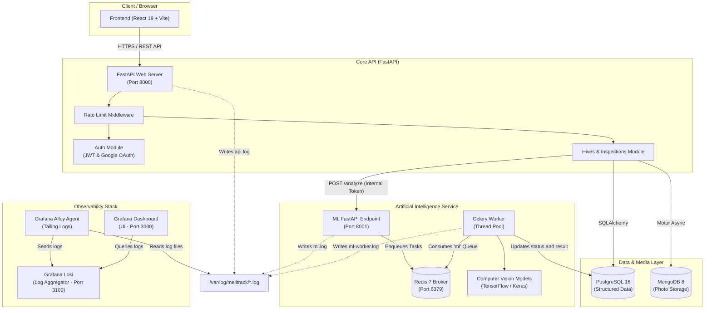
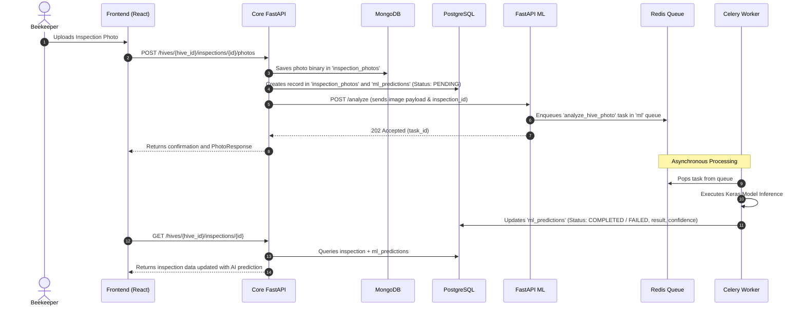

# System Architecture - Melitrack

**Melitrack** is built under a highly modular, microservices-oriented architecture based on Docker containers and decoupled into three main pillars: **Web Application (SPA/API)**, **Artificial Intelligence / ML Service**, and **Observability Stack**.

---

## Architecture Overview

The diagram below illustrates Melitrack's complete ecosystem, highlighting components, databases, inter-service communication, and log flow:

---

## System Components

### 1. Frontend (`frontend/`)

- **Technologies**: React 19, TypeScript, Vite, Tailwind CSS, Lucide Icons, React Router DOM.
- **Role**: User interface for stingless beekeepers. Allows registering and viewing hives on a map, uploading photos, recording inspections, tracking AI analysis results, and monitoring honey and byproduct production.

### 2. Core Backend API (`backend/api/`)

- **Technologies**: FastAPI, Python 3.12, SQLAlchemy ORM, Alembic, Motor (MongoDB Async), PyJWT, Passlib.
- **Role**: Serves as the API gateway and orchestrator of main business rules.
- **Highlights**:
  - **Hybrid Authentication**: Local password login (Bcrypt) + Social login via Google OAuth.
  - **Rate Limiter Middleware**: Protection against abuse and brute-force attacks (default rate limit and custom limits for auth/password reset).
  - **Polyglot Persistence**: Uses PostgreSQL for strict relational data and MongoDB for high-volume binary photo data.

### 3. Backend ML Service (`backend/ml/`)

- **Technologies**: FastAPI, Celery 5, Redis 7, TensorFlow/Keras, iNaturalist Client.
- **Role**: Service dedicated to compute-heavy artificial intelligence and computer vision tasks.
- **Asynchronous Architecture**:
  1. Core API sends a `POST /analyze` request to the ML API containing the inspection ID and Base64-encoded image, protected by an internal token (`X-ML-Service-Token`).
  2. ML API creates a task in **Redis** and immediately responds with `202 Accepted` and the `task_id`.
  3. The **Celery Worker** consumes the task from the `ml` queue, runs inference on the Keras model (`species_model.keras`), and saves the final result directly to the `ml_predictions` table in PostgreSQL.

### 4. Observability Stack (`observability/`)

- **Components**:
  - **Grafana Alloy**: Lightweight log collection agent monitoring the shared log directory `/var/log/melitrack/` (`api.log`, `ml.log`, `ml-worker.log`).
  - **Grafana Loki**: Log aggregation engine storing indexed logs by labels.
  - **Grafana**: Web dashboard for graphical log queries and system alerts.

---

## Network & Docker Compose Topology

All services communicate securely across a shared Docker bridge network named `melitrack-network`:

| Container Service | Container Name        | Internal Port | Host Port Exposed       | Role                        |
| :---------------- | :-------------------- | :------------ | :---------------------- | :-------------------------- |
| `api`             | `melitrack-api`       | 8000          | `${API_PORT}` (8000)    | Core API Server             |
| `db`              | `melitrack_db`        | 5432          | `${DB_PORT}` (5432)     | PostgreSQL Relational DB    |
| `mongo`           | `melitrack_photos`    | 27017         | `${MONGO_PORT}` (27017) | MongoDB NoSQL Database      |
| `ml`              | `melitrack-ml`        | 8000          | `${ML_PORT}` (8001)     | ML API Server               |
| `ml-worker`       | `melitrack-ml-worker` | -             | -                       | Celery Worker for ML        |
| `redis`           | `melitrack_redis`     | 6379          | `${REDIS_PORT}` (6379)  | Queue & Cache               |
| `loki`            | `melitrack-loki`      | 3100          | 3100                    | Log Aggregator              |
| `alloy`           | `melitrack-alloy`     | 12345         | 12345                   | Log Collector               |
| `grafana`         | `melitrack-grafana`   | 3000          | 3000                    | Monitoring UI               |

---

## Photo & AI Processing Workflow

