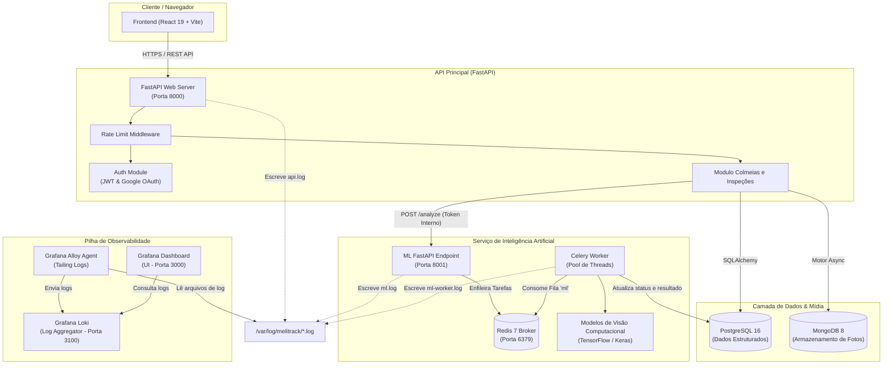
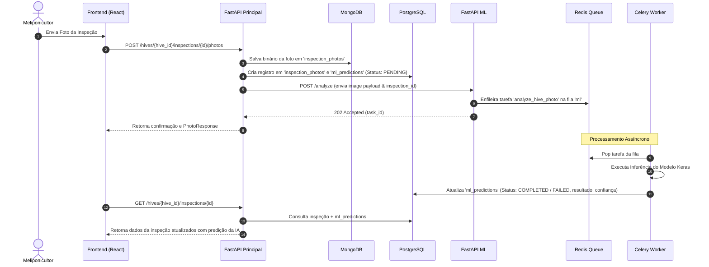

# Arquitetura do Sistema - Melitrack

O **Melitrack** é construído sob uma arquitetura orientada a microserviços, altamente modular, baseada em containers Docker e desacoplada em três pilares principais: **Aplicação Web (SPA/API)**, **Serviço de Inteligência Artificial / ML** e **Pilha de Observabilidade**.

---

## Visão Geral da Arquitetura

O diagrama abaixo ilustra o ecossistema completo do Melitrack, destacando os componentes, bancos de dados, comunicação entre microserviços e fluxo de logs:

---

## Componentes do Sistema

### 1. Frontend (`frontend/`)

- **Tecnologias**: React 19, TypeScript, Vite, Tailwind CSS, Lucide Icons, React Router DOM.
- **Função**: Interface de usuário para meliponicultores. Permite o cadastro e visualização de colmeias no mapa, registro de fotos, lançamento de inspeções, acompanhamento dos resultados de análise de IA e controle da produção de mel e derivados.

### 2. Backend API Principal (`backend/api/`)

- **Tecnologias**: FastAPI, Python 3.12, SQLAlchemy ORM, Alembic, Motor (MongoDB Async), PyJWT, Passlib.
- **Função**: Serve como a API gateway e regente de regras de negócio principais.
- **Destaques**:
  - **Autenticação Híbrida**: Login local com senha hash (Bcrypt) + Login social com Google OAuth.
  - **Rate Limiter Middleware**: Proteção contra uso abusivo e ataques de força bruta (limite padrão e limites específicos para autenticação/recuperação de senha).
  - **Persistência Poliglota**: Utiliza PostgreSQL para dados relacionais rigorosos e MongoDB para dados binários de alta volumetria (fotos).

### 3. Backend ML Service (`backend/ml/`)

- **Tecnologias**: FastAPI, Celery 5, Redis 7, TensorFlow/Keras, iNaturalist Client.
- **Função**: Serviço dedicado ao processamento pesado de inteligência artificial e visão computacional.
- **Arquitetura Assíncrona**:
  1. A API principal envia uma requisição `POST /analyze` para a ML API contendo o ID da inspeção e a foto codificada em Base64, protegida por um token interno (`X-ML-Service-Token`).
  2. A ML API cria uma tarefa no **Redis** e responde imediatamente `202 Accepted` com o `task_id`.
  3. O **Celery Worker** consome a tarefa da fila `ml`, executa a predição no modelo Keras (`species_model.keras`) e salva o resultado final diretamente na tabela `ml_predictions` do PostgreSQL.

### 4. Pilha de Observabilidade (`observability/`)

- **Componentes**:
  - **Grafana Alloy**: Agente leve de coleta de logs que monitora o diretório compartilhado de logs `/var/log/melitrack/` (`api.log`, `ml.log`, `ml-worker.log`).
  - **Grafana Loki**: Mecanismo de agregação e armazenamento de logs indexados por rótulos (labels).
  - **Grafana**: Dashboard web para consulta gráfica e criação de alertas de sistema.

---

## Rede & Docker Compose Topology

Todos os serviços se comunicam de forma segura através de uma rede bridge compartilhada do Docker denominada `melitrack-network`:

| Serviço Container | Nome do Container     | Porta Interna | Porta Host Exposta      | Função                      |
| :---------------- | :-------------------- | :------------ | :---------------------- | :-------------------------- |
| `api`             | `melitrack-api`       | 8000          | `${API_PORT}` (8000)    | Servidor API Principal      |
| `db`              | `melitrack_db`        | 5432          | `${DB_PORT}` (5432)     | Banco Relacional PostgreSQL |
| `mongo`           | `melitrack_photos`    | 27017         | `${MONGO_PORT}` (27017) | Banco NoSQL MongoDB         |
| `ml`              | `melitrack-ml`        | 8000          | `${ML_PORT}` (8001)     | Servidor API de ML          |
| `ml-worker`       | `melitrack-ml-worker` | -             | -                       | Worker Celery para ML       |
| `redis`           | `melitrack_redis`     | 6379          | `${REDIS_PORT}` (6379)  | Fila e Cache                |
| `loki`            | `melitrack-loki`      | 3100          | 3100                    | Agregador de Logs           |
| `alloy`           | `melitrack-alloy`     | 12345         | 12345                   | Coletor de Logs             |
| `grafana`         | `melitrack-grafana`   | 3000          | 3000                    | Interface de Monitoramento  |

---

## Fluxo de Processamento de Fotos & IA

